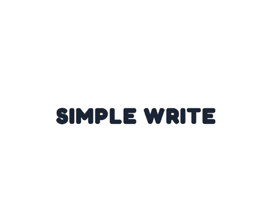

<p align="center">
  
</p>

<h1 align="center">Simple Write</h1>

<p align="center">
  A desktop Markdown editor for one file at a time.<br />
  Open a document from anywhere, write on a formatted page, and switch to the source when you want the raw Markdown.
</p>

<p align="center">
  
</p>

## Install

Builds are published for Windows and Linux on the [releases page](https://github.com/DJRCX/simple-write/releases).

| System | What to download |
| --- | --- |
| Windows | The `.msi` or `.exe` installer |
| Linux | A `.deb`, `.rpm`, or the `.AppImage` |

The AppImage can be run directly. On Debian and Ubuntu, install the `.deb`. On Fedora and other RPM systems, install the `.rpm`.

## What it does

Each tab is its own file. There is no notebook folder or vault. You can open a document from anywhere, keep several files open, and save each one back where it came from.

The formatted page works like a block editor:

- Headings, lists, tasks, quotes, tables, code, images, math, and Mermaid diagrams
- A **+** beside a block to insert the next one, and a drag handle to move it
- Alignment, syntax colors, and a slash menu (`/`)
- Find, a light or dark theme, and a focus mode that hides the toolbar
- Images copied beside the saved file, and `[[name]]` links that open a sibling note when that file exists

Ctrl+Shift+M switches between the formatted page and the raw Markdown. The file on disk stays as you saved it until you edit.

## Shortcuts

| Action | Shortcut |
| --- | --- |
| New | Ctrl+N |
| Open | Ctrl+O |
| Save | Ctrl+S |
| Save As | Ctrl+Shift+S |
| Close tab | Ctrl+W |
| Find | Ctrl+F |
| Next tab | Ctrl+Tab |
| Formatted / Markdown | Ctrl+Shift+M |
| Focus mode | Ctrl+Shift+Enter |
| Bold, italic, link | Ctrl+B, Ctrl+I, Ctrl+K |
| Indent | Tab inserts four spaces. In a list, Tab nests the item. |

## Develop

```bash
npm install
npm run tauri dev
```

`npm run dev` opens a browser preview. That preview keeps the document in memory and downloads it on save. Native open, save, drag-and-drop, and opening a file from the command line need the desktop window.

```bash
npm test
```
